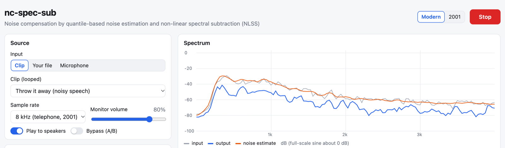

# nc-spec-sub

[](https://github.com/benoitfauve/nc-spec-sub/actions/workflows/ci.yml)

Real-time **noise compensation** for speech: quantile-based noise estimation and
non-linear spectral subtraction (NLSS), followed by two IIR filters. It runs in the
browser and on the command line, with one TypeScript DSP core. The name stands for
**n**oise **c**ompensation by **spec**tral **sub**traction.

It re-creates a 2001 real-time demo (an MFC / Visual C++ app) built at the Speech and
Image Group (SIG), University of Wales Swansea, by John Mason (group lead), Nicholas
Evans (PhD candidate) and Benoît Fauve (Erasmus student from ENSPM, now Centrale
Marseille), as a side demo for:

- N. W. D. Evans, J. S. Mason, *Noise estimation without explicit speech, non-speech
  detection: a comparison of mean, modal and median based approaches*, Eurospeech 2001.
- N. W. D. Evans, J. S. Mason, B. Fauve, *Efficient real-time noise estimation without
  explicit speech, non-speech detection: an assessment on the AURORA corpus*, DSP 2002.

The web app has two views over the same engine: a **modern** one, and a faithful **2001**
Windows-style re-creation of the original dialog.

**Live demo**: <https://benoitfauve.github.io/nc-spec-sub/> (runs in the browser, no audio leaves the device).



## Quick start

Requires Node.js 23.6 or later (it runs the TypeScript sources directly). No Python needed.

```bash
npm install
npm run dev          # web app on http://localhost:5173 (mic works on localhost)
npm test             # DSP tests
npm run typecheck
npm run build        # static site in apps/web/dist (no server needed)
```

Command line:

```bash
npm run ncspec -- --help
npm run ncspec -- process noisy.wav -o clean.wav --preset paper
npm run ncspec -- process speech.wav -o out.wav --noise car.wav --snr 5 --clean speech.wav
npm run ncspec -- design --kind cheby1 --response highpass --cutoff 300 --order 6 --ripple 0.1
npm run ncspec -- gen-synthetic --out testdata/synthetic
```

## How it works

```
input → gain → add noise → NLSS → filter 1 → filter 2 → limiter → output
                           │
                           ├─ STFT (32 ms frames; modern: sqrt-Hann, 50% overlap / 2001: blocks)
                           ├─ running quantile of past spectra per bin (median = noise estimate)
                           └─ power spectral subtraction: |Y|² = max(|X|² − α·N², β·|X|²)
```

- **Presets**: `listening` (low musical noise), `paper` (the published set-up: 0.5 s
  median at a 16 ms rate, α = 0.25), `legacy-2001` (the demo's defaults).
- **Filters** are designed on the fly (Butterworth, Chebyshev I and II, low or high-pass).
  The design reproduces all 1,282 non-empty, designable coefficient files of the 2001
  filter bank exactly.
- In the browser the engine runs in an AudioWorklet (mic or looped clip, live), and in a
  Web Worker for faster-than-real-time export. No audio leaves the device.

## Minimal version

`packages/dsp/src/specsub.ts` is the first, minimal version of the algorithm: a
running-median noise estimate and power spectral subtraction in about 100 lines, kept
as a readable reference next to the streaming `nlss.ts` used by the web app and `ncspec`.

### Usage

```bash
node packages/cli/src/specsub.ts in.wav out.wav [--alpha 2] [--beta 0.01] [--warmup grow]
```

Input can be any PCM (8 to 32-bit) or float WAV; channels are mixed to mono. Output is
16-bit mono at the input sample rate.

| Option | Default | Meaning |
|---|---|---|
| `--alpha` | 2 | Over-subtraction factor on the noise power. Higher removes more noise and adds more musical noise. |
| `--beta` | 0.01 | Spectral floor, as a fraction of the noisy power (0.01 is -20 dB). |
| `--warmup` | grow | How the median window starts. `grow`: median of the frames seen so far. `zeros`: the window starts full of zeros, as in the 2001 demo, so nothing is subtracted until half the window holds real frames. |

### Example

`testdata/2001/throwitaway.noisy.wav` is "throw it away" spoken in car noise (8 kHz, 2.8 s).

```bash
node packages/cli/src/specsub.ts testdata/2001/throwitaway.noisy.wav out/throwitaway.clean.wav
```

The same thing as an npm script:

```bash
npm run demo
```

Try a gentler setting (alpha 0.25 gave the best speech recognition results in the
Eurospeech 2001 study) and compare by ear:

```bash
node packages/cli/src/specsub.ts testdata/2001/throwitaway.noisy.wav out/throwitaway.a025.wav --alpha 0.25
```

### How it works

```
x → STFT → |X|² ─┬─────────────────────────────┐
                 └→ median of last 0.5 s → N   │
                                               ▼
               |Y|² = max(|X|² − α·N, β·|X|²)  → gain √(|Y|²/|X|²) → ISTFT → y
```

- **Frames**: 32 ms (256 samples at 8 kHz), 50% overlap, square-root Hann window on
  analysis and synthesis, so overlap-add reconstructs the signal exactly when no gain
  is applied.
- **Noise estimate**: for each frequency bin, the median of the power over the last
  0.5 s of frames (31 frames at 8 kHz). Speech occupies a given bin for less than half
  of that window most of the time, so the median follows the noise without a voice
  activity detector. Each bin's window is kept sorted and updated with one removal and
  one insertion per frame instead of a full sort; see
  [sliding-median.md](sliding-median.md).
- **Subtraction**: the gain is applied to the complex spectrum, so the noisy phase is
  kept.

### Notebook

[notebooks/how-it-works.ipynb](notebooks/how-it-works.ipynb) walks through the
algorithm step by step on the example recording: noisy spectrogram, the median noise
estimate in one bin and in all bins, the gain mask, before and after, the effect of
alpha and of the floor beta, and what happens to a steady tone added to the
recording, with audio players.

The plots come from the TypeScript code itself: `packages/cli/src/trace.ts` runs the same
`spectralSubtract` and saves its per-frame internals to `out/trace/`, and the notebook
only loads and plots them.

```bash
node packages/cli/src/trace.ts testdata/2001/throwitaway.noisy.wav out/trace/alpha-2   # what the notebook runs
```

To run the notebook you need Node on the `PATH` and a Python environment with numpy,
matplotlib and ipykernel. It is committed without outputs: run it to see the plots and
listen to the audio. Outputs are stripped on commit by
[nbstripout](https://github.com/kynan/nbstripout); after cloning, set it up with
`pip install nbstripout && nbstripout --install --attributes .gitattributes`.

## Layout

| Path | Content |
|---|---|
| `packages/dsp` | DSP core: FFT, quantile estimator, NLSS, filter design, pipeline, WAV I/O, minimal `specsub.ts` (no dependencies) |
| `packages/cli` | `ncspec` command-line tool (Node); `specsub.ts` and `trace.ts` for the minimal version |
| `apps/web` | Vite + Preact web app: modern view, 2001 view, AudioWorklet, worker |
| `testdata` | Test audio: 2001 recordings (CC BY 4.0), MUSAN noise excerpts, one LibriSpeech clean utterance (CC BY 4.0); synthetic signals are generated, `synthetic/` and `private/` are git-ignored |
| `notebooks` | `how-it-works.ipynb`, the minimal version step by step |
| `sliding-median.md` | How the sorted-window median update works |

## Development

```bash
npm run typecheck
npm run lint         # oxlint
npm run format       # prettier
npm test
```

The same four checks run before each commit through [pre-commit](https://pre-commit.com/)
(`.pre-commit-config.yaml`), and in GitHub Actions on every push and pull request
(`.github/workflows/ci.yml`). Pushes to `main` also build the web app and deploy it to
GitHub Pages (`.github/workflows/pages.yml`). After cloning:
`pip install pre-commit && pre-commit install`.

## Licence and credits

Code: MIT (see `LICENSE`). Audio and logos keep their own licences: see `NOTICE.md`
and `testdata/ATTRIBUTION.md`. The 2001 recordings are CC BY 4.0 (Benoît Fauve and the
Speech and Image Group, University of Wales Swansea). The crest and SIG logo in the
2001 view are not covered by the MIT licence. The 2001 filter bank is used locally only (`testdata/private/`,
never committed).
